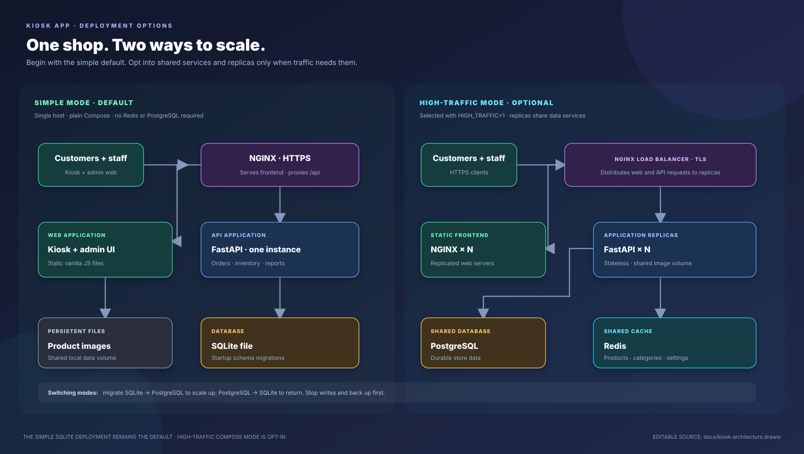

# Kiosk App

[](https://github.com/636B65/kiosk-app/actions/workflows/ci.yml)
[](https://github.com/636B65/kiosk-app/releases/latest)
[](https://636b65.github.io/kiosk-app/)
[](https://github.com/636B65/kiosk-app/commits/main)
[](LICENSE)

[](https://scorecard.dev/viewer/?uri=github.com/636B65/kiosk-app)
[](https://github.com/636B65/kiosk-app/actions/workflows/scorecard.yml)
[](https://github.com/636B65/kiosk-app/actions/workflows/cflite.yml)
[](SECURITY.md)
[](.github/dependabot.yml)
[](SECURITY.md)

[](backend/Dockerfile)
[](https://fastapi.tiangolo.com/)
[](https://www.sqlite.org/)
[](frontend/nginx.conf)
[](https://github.com/636B65?tab=packages&repo_name=kiosk-app)
[](tests/e2e)
[](https://github.com/636B65/kiosk-app-ms)

A self-service retail kiosk with a customer-facing ordering screen and an admin
panel. Customers browse products, put them in a cart, and buy on a credit/tab
basis using a username. An admin user views sales, manages products, and tracks
customer balances.

The deployment runs fully **offline (air-gapped)** via Docker Compose: one
FastAPI backend with a SQLite database behind an HTTPS nginx frontend.

## Live demo

Try the frontend without a backend: **https://636b65.github.io/kiosk-app/**

GitHub Pages hosts the static frontend with an in-browser mock of the API
(`frontend/js/demo.js`), so the whole kiosk + admin panel is interactive with
sample data. Everything lives in your browser and **resets on reload**.

- Demo mode triggers automatically on GitHub Pages (or manually with `?demo=1`
  on any static server).
- Admin login for the demo: **`admin`** / `demo-password123`.

## Features

**Customer kiosk** (`/`)
- Browse products by category with live search
- Add/remove items in a cart with running totals
- Checkout by entering a username (auto-creates the customer on first purchase)
- Confetti celebration animation when an order is completed
- Purchases are added to the customer's balance (paid later at the counter)
- "User lookup" to view your balance, stats, and full monthly order history
  (typing a username suggests matching existing customers)
- All prices in **EUR** (admin can change the currency in Settings)
- Product photos uploaded by the admin (PNG/JPEG/WebP/GIF, up to 5 MB)
- Weekly specials: admin marks products with a special price and they appear at
  the top of the shop with the discounted price; a special can be scheduled to
  start and end on given dates and switches itself on and off
- "Buy again" in the user lookup: the customer's most-bought products as one-tap
  buttons that add straight to the cart
- Optional PIN (4–8 digits) per customer, set from the user lookup: with a PIN nobody can
  buy on the tab, see the balance or self-mark it paid without it. PINs are stored as
  Argon2id over a peppered HMAC (the pepper lives in `data/pin_pepper.key`, outside the
  database and its backups — keep a copy of that file), 5 wrong PINs lock the account for
  15 minutes, and staff can only remove a forgotten PIN once the balance is paid
- The cursor jumps to the username (and PIN) field on Buy and User lookup; Esc closes
  dialogs
- Self-scanning of product barcodes at the kiosk, off by default (Settings)
- "Pay": a button (shown once the admin has set up at least one payment method) that tells the
  customer how to pay: bank account, a phone number (e.g. Swish), a QR code, a link or free
  text. From the user lookup it also shows the amount and asks for the username as the message
- Light and dark mode: the footer's theme switch picks Auto (follow the device), Light or
  Dark, remembered per browser
- Idle reset: after a configurable time without a touch (default 90 s) the kiosk
  warns for 10 seconds, then clears the cart and closes open dialogs so the next
  customer never sees the previous one's cart or balance

**Admin panel** (`/#admin`)
- Dashboard: outstanding balance, today/week/month/all-time sales, this month's
  margin, and a "Restock needed" list (each product has its own alert threshold)
- Restocking: record deliveries with quantity, purchase price and a note; the
  delivery history is kept and the purchase price feeds the margin report
  (purchase prices are staff-only and never sent to the kiosk)
- Products/Categories management, including product image upload and weekly
  specials (special price, listed at the top of the shop)
- Barcode-assisted product setup and kiosk checkout (a product can have multiple
  barcode aliases)
- Orders with paid/cancelled statuses and per-order item detail
- Customers: balances, per-customer stats, monthly history, reset payment
- Reports with outstanding balance, sales breakdown, customer/product leaderboards
  (counting sales on credit by default, or paid orders only),
  recent payment insights, margins per product (today/week/month/all time, using the
  purchase price at the time of sale), and CSV export of inventory (selling and cost
  value), restock needs, margins, customer balances, and report data
- Inventory: count the shelf, book differences with a reason (missing, damaged,
  expired, ...) and follow shrinkage per product and period, valued at the purchase price
- Reorder suggestions from the recent sales pace and each product's low-stock threshold,
  with estimated cost, CSV export and print view
- Printable account statement per customer and month (purchases, payments, balance)
- Money: enter what you bought in (a purchase can be entered afterwards with its real date and
  corrected later). Customers buy on credit, and as orders are marked paid the money lands in
  the store balance, so once everyone has paid you see if the store ended in plus, minus or
  even; until then it shows where you end if everyone pays
- Extra payments: when a customer pays more than they owe, Reset payment takes the extra amount.
  It is store income that covers shrinkage (not credit on the customer), compared with the
  shrinkage found by counts
- Payment info for the kiosk's Pay button is chosen in Settings: bank account, phone number,
  QR code (uploaded image), link or text, each shown or hidden
- Audit log: who marked orders paid or cancelled, reset or self-marked payments,
  changed products, prices, stock, settings or users, and took backups, and when
- System page: backend/frontend version, uptime, database size, counts, and backups
  (automatic SQLite backups every 24 h by default, newest 7 kept, "Back up now",
  download)
- User management (admin accounts)
- Optional customer self-service payment: when enabled in Settings, the kiosk lookup
  offers "I have paid everything" (off by default; it does not verify identity or payment)

## Architecture

The kiosk runs as a single host: nginx serves the web app over HTTPS and proxies
`/api` to one FastAPI backend, which stores everything in a SQLite file.



For a guided product overview, view the [sales presentation (PDF)](docs/kiosk-sales-presentation.pdf)
or open the [interactive HTML version](docs/kiosk-sales-presentation.html).
The editable source diagram is [available in draw.io format](docs/kiosk-architecture.drawio).

## Tech stack

| Layer     | Technology                                              |
|-----------|---------------------------------------------------------|
| Backend   | Python 3.12, FastAPI, SQLAlchemy, SQLite, JWT auth      |
| Frontend  | Vanilla HTML/CSS/JS served by nginx                     |
| Runtime   | Docker Compose (backend + nginx frontend)               |
| Storage   | SQLite database file bound-mounted at `./data/kiosk.db`; product images
              stored in `./data/product_images/` |

## Getting started

Requires Docker with the Compose plugin.

### Quick start with the published images (no build)

The release images on GitHub Container Registry are public, so the app runs
without cloning or building anything. In an empty folder:

```bash
curl -fsSLO https://raw.githubusercontent.com/636B65/kiosk-app/main/docker-compose.prebuilt.yml
printf 'SECRET_KEY=%s\nADMIN_PASSWORD=change-me-please\n' "$(openssl rand -hex 32)" > .env
docker compose -f docker-compose.prebuilt.yml up -d
```

Open https://localhost (accept the self-signed certificate) and log in at
https://localhost/#admin as `admin` with the password from `.env`. Everything is
stored in `./data`. Add `KIOSK_VERSION=1.5.0` to `.env` to pin a release
(default: the newest). To update: `docker compose -f docker-compose.prebuilt.yml pull`
and `docker compose -f docker-compose.prebuilt.yml up -d`; the database is migrated
on start (back up `./data` first).

### Build from source

```bash
docker compose up --build
```

`./compose.sh` runs the same stack and stamps the build with `git describe`.
The footer (and the admin System page) shows the running release and commit.
A plain `docker compose up --build` takes them from the checkout: the newest
`CHANGELOG.md` version and the checked-out git commit (no git needed in the
image; without a `.git` folder only the version is shown). `./compose.sh` uses
`git describe` instead, and `APP_VERSION` / `GIT_COMMIT` override both. The
footer's **Changelog** button opens `CHANGELOG.md`.

- Customer kiosk: https://localhost
- Admin panel: https://localhost/#admin
- Plain HTTP on port 80 redirects to HTTPS (443).
- Default admin login: set the `ADMIN_PASSWORD` environment variable before
  first start; if unset a strong random password is generated and printed in
  the backend logs on first boot. **No hardcoded default credentials are used.**

The backend runs on http://localhost:8000 (bound to host loopback only; it is
**not** reachable from the LAN/WAN) and the frontend nginx proxies `/api/`
requests to it over Docker's internal network.

### Configuration

- **`SECRET_KEY`** (JWT signing key): set a strong, stable value before
  deployment, e.g. `docker compose run -e SECRET_KEY=$(openssl rand -hex 32) ...` or
  in your `.env` used by Compose. If unset, a random key is generated at startup
  (which invalidates existing sessions on restart). **Never use a hardcoded key.**
- **`ADMIN_PASSWORD`**: used to create the `admin` account on first boot. If unset,
  a random password is generated and printed in the backend logs.

### TLS / HTTPS

- The frontend serves HTTPS on port 443 and redirects port 80 to it.
- On **first** start (`docker compose up --build`) a **self-signed certificate**
  is generated into `./data/tls/server.crt` + `server.key` (bind-mounted to
  `/etc/nginx/certs` inside the container). Your browser will show a warning
  for self-signed certificates — accept it for local use.
- The certificate is **never overwritten** once it exists, so you can later
  replace it with a real (CA-signed) certificate by dropping your own
  `server.crt` / `server.key` into `./data/tls/` and restarting the frontend:
  `docker compose restart frontend`.

### Database

- Data lives in `./data/kiosk.db` (a bind mount, not baked into the image).
- Uploaded product images live in `./data/product_images/` (same bind mount, so
  they survive container rebuilds too).
- **Migrations run automatically** on backend startup — existing databases are
  upgraded in place, so updates never require a manual step or data wipe.
- **Automatic backups** (SQLite): a consistent copy of the database is written to
  `./data/backups/` every 24 hours (Settings: interval, `0` = off; how many to keep,
  default 7). The admin **System** page lists them, takes one on demand and
  downloads them. Backups cover the database only, not product images, and they
  live on the same disk, so copy them elsewhere now and then.
- **Keep `./data/pin_pepper.key`** together with the database: customer PINs are
  hashed with this secret, and it is deliberately not part of the app's backups.
- Back up the DB (and product images) before updates:
  `cp -r data data.bak`

## Project layout

```
backend/            FastAPI application (models, routers, auth, seed, migrations)
  routers/          API route modules (auth, categories, customers, orders, ...)
frontend/           Static customer kiosk + admin panel (HTML/CSS/JS, nginx)
docker-compose.yml  Services: backend (8000) + frontend (80->443 HTTPS)
build-offline.sh    Build images + bundle for an air-gapped target
deploy-offline.sh   Load + start the bundled images on an offline machine
```

## Air-gapped (offline) deployment

The app makes **no outbound network calls at runtime** and only talks to its own
backend over Docker's internal network. The internet is required only to *build*
the images. This makes it easy to ship to an isolated machine.

On an internet-connected machine:

```bash
./build-offline.sh [amd64|arm64] [--include-data]
```

This produces a single `offline/kiosk-app.tar.gz` containing the built images,
`docker-compose.yml`, and `deploy-offline.sh`.

On the offline target (with Docker installed):

```bash
./deploy-offline.sh kiosk-app.tar.gz
```

It unpacks the bundle, verifies checksums, backs up and preserves your live
database, loads the images, and starts the services. `--no-verify` skips the
checksum check. See the scripts for details.

> **First deploy:** pass `--include-data` to bundle your current DB. For
> **updates**, do not use `--include-data` — the live DB on the target is
> preserved and migrated automatically.

## Container images (GitHub Packages / GHCR)

On every `v*` release tag, GitHub Actions builds the two images and publishes
them to the GitHub Container Registry (GHCR):

- `ghcr.io/636b65/kiosk/backend`
- `ghcr.io/636b65/kiosk/frontend`

Images are tagged with the SEMVER version (`v1.4.0` -> `1.4.0`) and `latest`,
and are built for `linux/amd64`. The packages are **public**: no login or token is
needed to pull them.

`docker-compose.yml` still builds from source locally, so GHCR is an optional
distribution channel rather than a hard dependency (useful for air-gapped
deployments where you pull once on a connected machine).

To pull images directly:

```bash
docker pull ghcr.io/636b65/kiosk/backend:latest
docker pull ghcr.io/636b65/kiosk/frontend:latest
# or pin a release, e.g. :1.4.0
```

Note: GHCR package names are lowercase regardless of the account spelling.

## Development

The backend uses FastAPI with hash-locked dependencies in `backend/requirements.txt`
(generated by pip-compile from `requirements.in`; edit the `.in` file and re-run
`pip-compile --generate-hashes --allow-unsafe requirements.in`).
Run tests/verification with the FastAPI `TestClient` and Playwright browser
tests, or simply exercise `docker compose up --build`.

## Testing

GitHub Actions runs both suites automatically on push to `main` and on pull
requests (see `.github/workflows/ci.yml`). Run them locally:

**Backend API tests** (pytest + FastAPI TestClient):

```bash
cd backend
pip install --require-hashes -r requirements-dev.txt
pytest tests -v
ruff check .
mypy
```

**End-to-end tests** (Playwright against a live backend + nginx-proxied
frontend, no Docker needed):

```bash
cd tests/e2e
npm install
# requires a Python 3.12 interpreter with backend deps installed
E2E_PYTHON=python CHROMIUM_PATH=/usr/bin/chromium npm test
```

**Docker + TLS smoke test** (the full delivered stack, incl. the self-signed
certificate, HTTP->HTTPS redirect, CSP header, and admin login over TLS):

```bash
docker compose up -d --build
cd tests/e2e && CHROMIUM_PATH=/usr/bin/chromium ADMIN_PASSWORD=smoke-test-password node https-smoke.js
```

The e2e harness spawns its own backend and a static/proxy server, then drives
`chromium`. Set `E2E_PYTHON` to a Python that can run the backend
(`requirements-dev.txt` installed), and `CHROMIUM_PATH` to a Chromium binary.

## Security

Report vulnerabilities privately, see [SECURITY.md](SECURITY.md). The repository is
checked by [OpenSSF Scorecard](https://scorecard.dev/viewer/?uri=github.com/636B65/kiosk-app),
CodeQL (GitHub's default setup) and ClusterFuzzLite (fuzzers in `tests/fuzz/`). Actions are pinned to commit SHAs,
base images to digests and Python dependencies to hashes (Dependabot keeps them current),
and published images carry signed build provenance:
`gh attestation verify oci://ghcr.io/636b65/kiosk/backend:<version> -R 636B65/kiosk-app`.

## License

[MIT](LICENSE)
